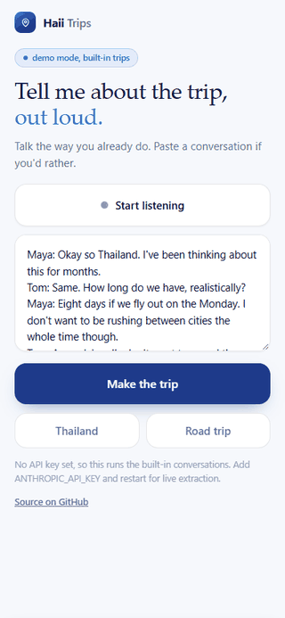
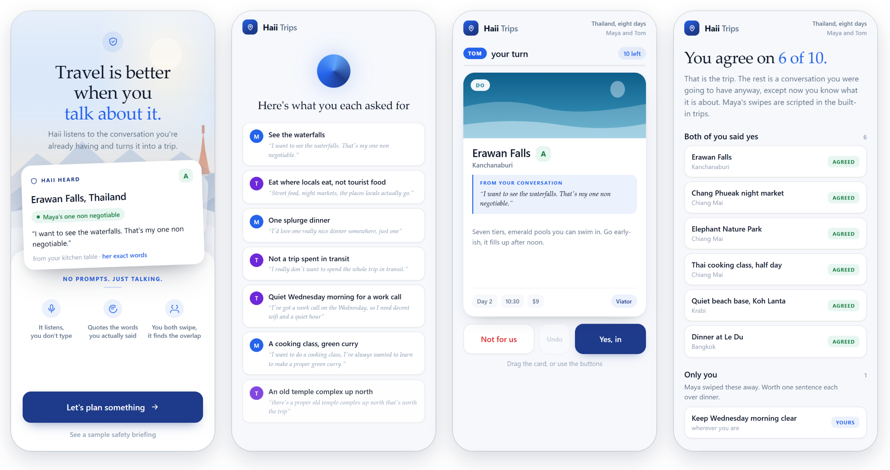
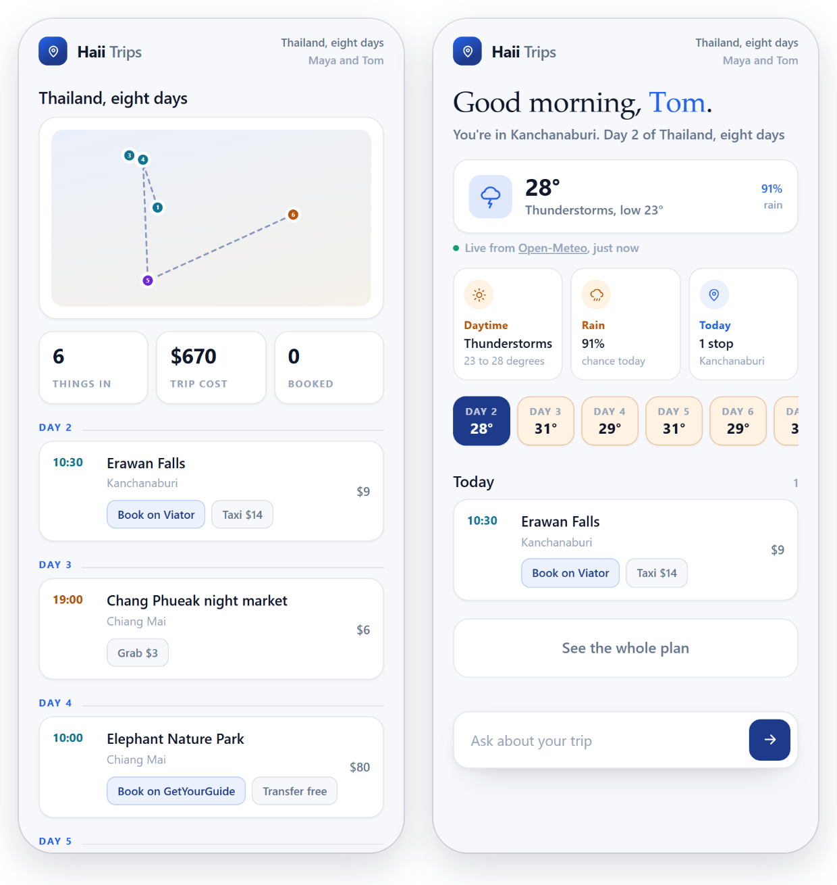

<h1 align="center">Haii Trips</h1>

<p align="center"><strong>A conversation becomes a trip.</strong><br>
Two people talk about where they want to go. Each swipes a deck built from their own words.<br>
The trip is what they both said yes to.</p>

<p align="center">
<a href="https://ardaasaroglu.github.io/haii-trips/haii-trips-demo.html"><strong>Try the live demo</strong></a> (in your browser, no sign-up, no key) ·
<a href="#run-it">Run it locally</a> ·
<a href="#what-is-real-and-what-is-simulated">What is real</a>
</p>

<p align="center"><a href="https://github.com/ardaasaroglu/haii-trips/actions/workflows/check.yml"></a></p>

<p align="center"></p>

> **A prototype, and that is the point.** Zero dependencies: one HTML file and a small Node server you start with `node server.js`. With no setup it runs two built-in trips. In those two the second person's swipes are scripted and labelled simulated. Add your own Claude API key and it builds a deck from any conversation, for one swiper. Bookings and rides are simulated and say so on screen. The live demo is a single static file and plays only the two built-in trips.

## Why it exists

Most AI travel apps open with a prompt box. People plan trips by talking to whoever they are going with, and that conversation already holds most of what a planner needs: the one thing somebody will not skip, the budget, the 6am starts nobody wants.

Haii Trips listens to that conversation instead of asking for a prompt.

## How it works

1. **Talk or paste.** Dictate in the browser, or paste a conversation.
2. **It shows what it heard.** One line per want, with who said it and the words it came from.
3. **You swipe the deck.** Every card carries the quote that caused it. A card nobody asked for carries no quote and says so.
4. **The overlap is the trip.** In the two built-in trips a scripted second swiper goes next, and the overlap sorts the cards into both said yes, only you, only them and neither. A trip from your own conversation has one swiper and goes straight to the plan.
5. **The plan becomes the trip.** A day by day plan on a map, then an in-trip view with real weather that offers to move an outdoor stop to a drier day when the forecast spoils it.



<p align="center"></p>

## The one rule

**Every card quotes something a person actually said, or it carries no quote and says so.**

A plausible sentence in italics looks exactly like a real one, so the built-in trips are checked rather than trusted. `npm run check` covers the two handwritten trips and fails if any quote is not found word for word in its source conversation. Live model output is not checked by code. The model is told to quote exactly, and a live quote is usually exact, but it is not guaranteed.

## Run it

Node 18 or newer (CI runs Node 22). Nothing to install.

```bash
git clone https://github.com/ardaasaroglu/haii-trips.git
cd haii-trips
node server.js
```

Open <http://localhost:4830>. Pick the Thailand or the road trip conversation, or paste your own.

On Windows, double-click `Haii Trips.cmd` for a real app window. It starts the server, opens Chrome or Edge in app mode, and stops the server when the window closes.

## Bring your own Claude key

Without a key, whatever you paste returns one of the two built-in trips. That is deliberate: the demo works with zero setup.

With a key, the local server sends the conversation to the Claude API and builds the deck from it. If that call fails, the page says why and shows the built-in Thailand trip, marked as a fallback. In a live trip the model also supplies the places, prices and coordinates, and nothing verifies them.

```bash
cp .env.example .env        # Windows cmd: copy .env.example .env
# then put your key in .env:  ANTHROPIC_API_KEY=sk-ant-...
```

The key never reaches the browser. The local server reads it and sends it only to `api.anthropic.com`. The default model is `claude-sonnet-5-5`. To choose another, set the `MODEL` environment variable before starting the server. `.env` is read for the key only, so `MODEL` and `PORT` must be set in the environment. The server asks the model for low effort, so pick a model that supports the effort setting.

## What is real and what is simulated

| Part | Status |
| --- | --- |
| Weather | **Real.** Open-Meteo, no key and no account. A local run fetches the forecast live. The hosted demo shows a forecast saved when the demo was built. |
| Extraction | **Real with your key.** Two built-in trips without one. In a live trip the places, prices and coordinates come from the model and nothing verifies them. |
| Quotes | **Checked** in the two built-in trips by `npm run check`. Not checked by code in a live trip, so a live quote is usually exact but not guaranteed. |
| Dictation | **Real.** The browser's own speech recognition, in Chrome or Edge. In Chrome and Edge the audio goes to the browser maker's speech service. |
| The second swiper | **Simulated.** In the two built-in trips the second person's swipes are scripted and the screen says so. A trip built from your own conversation has one swiper. |
| Bookings and rides | **Simulated.** No vendor is contacted and no money moves. Every sheet is stamped Demo. |
| Safety briefings | **Handwritten** for six destinations and stamped as a demo on screen. Not live intelligence. |
| Map | Numbered dots joined by straight lines, drawn from each card's coordinates. No map tiles and no routing. |
| Imagery | Procedural SVG. No photography. |

Prices, times and notes in the built-in trips were written by hand and are illustrative. Brand names such as Viator, GetYourGuide, Booking.com, OpenTable, Grab, REI and Uber belong to their owners. They appear only as examples: places a real booking would go (Viator, GetYourGuide, Booking.com, OpenTable), rides (Grab, Uber) and a shopping stop (REI). Nothing here is affiliated with or endorsed by any of them.

## Privacy

It runs on your machine and keeps the trip in `data/trip.json`. Three things can leave it. With a key, your conversation, your plan and any question you ask about it go to the Claude API. Without a key they stay local. The coordinates of the places in your plan go to Open-Meteo for the forecast. If you dictate, the browser sends your audio to its speech service, which in Chrome is Google. [SECURITY.md](SECURITY.md) has the details and says how to report a vulnerability.

## How it is built

```text
┌───────────────────────────────────────────────────┐
│  public/index.html     one file, no framework     │  deck, swipe physics, map, live view
├───────────────────────────────────────────────────┤
│  server.js             node:http and fetch        │  extraction, state, weather, demo bookings
├─────────────────┬────────────────┬────────────────┤
│  data/trip.json │   Claude API   │   Open-Meteo   │  a JSON file · your key · no key
└─────────────────┴────────────────┴────────────────┘
```

Zero dependencies. No `npm install`, no database, and no build step to run it.

| Command | What it does |
| --- | --- |
| `npm run dev` | Starts the server on port 4830. Set `PORT` to change it. |
| `npm run check` | Checks both built-in trips, including that every quote appears word for word in its source conversation. The server must be running with no API key set. |
| `node build-standalone.js` | Bakes `haii-trips-demo.html`, the single file behind the live demo, with the forecast saved at build time. The server must be running with no API key set. |

Run the check and the demo build without a key. With one they would call the model and test or bake its output instead of the built-in trips, so both refuse to run.

## Contributing

Small, focused changes are welcome. Read [CONTRIBUTING.md](CONTRIBUTING.md) first. `CLAUDE.md` holds the invariants and the traps already hit in this codebase, for anyone working on it with a coding agent. If you find this useful, star the repo or open an issue.

Sister project: [Haii](https://github.com/ardaasaroglu/haii) reads a meeting and turns each promise you made into a card with the exact sentence you said.

## License

MIT. See [LICENSE](LICENSE).
